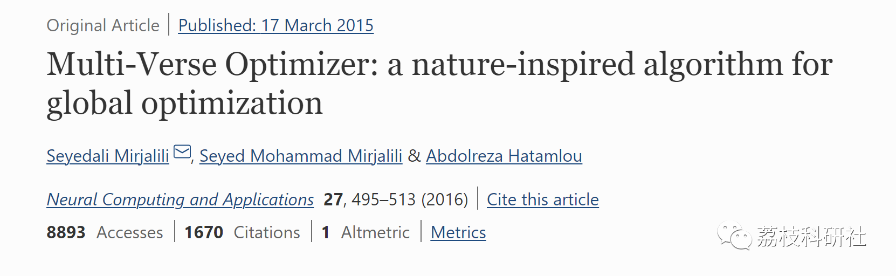
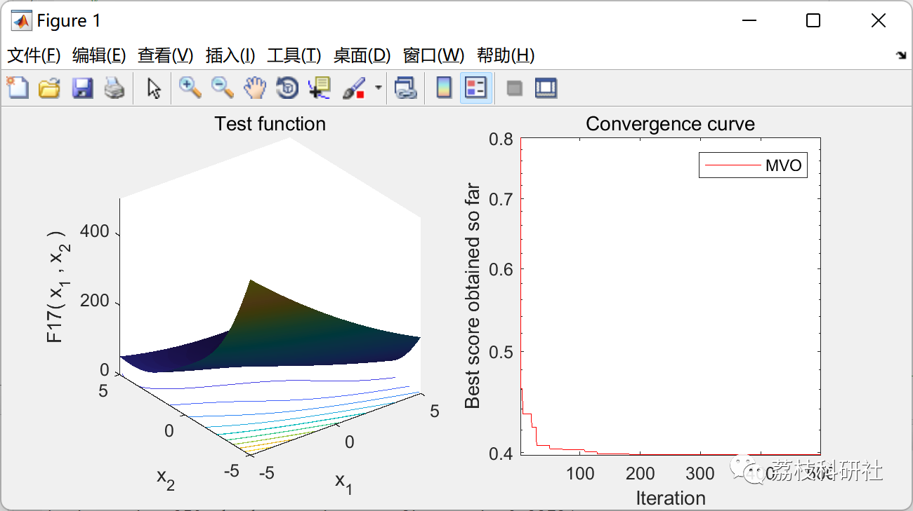

# Optimization Algorithm for the Metaverse (Matlab Code Implementation)

💥💥💥💞💞💞💞 Welcome to this blog❤️❤️❤️💥💥💥
🏆 Bloggers' Advantage: 🌞🌞🌞 The content of the blog strives to be rigorous in thought and clear in logic, for the convenience of readers.
⛳️ Mantra: The journey of a hundred miles is half done in the last ninety.
Litchi Research Society
Code Collection: Power System, Intelligent Algorithms and Applications, Neural Network Prediction, Path Planning, Optimized Scheduling, Workshop Scheduling, Image Processing, Signal Processing...
🎁Column Directory Link:
🌈🌈🌈🌟🌟🌟Electrical Code Intelligent Algorithm and Its Application Path Planning Neural Network Predictive Optimization Scheduling Image Processing Workshop Scheduling Signal Processing Romantic Her My Philosophical Thoughts Math Modeling Complete Code Matters
💥1 Overview
Naturally, nature has always been the primary source of inspiration for most group-based stochastic optimization techniques. As the name suggests, they perform optimizations randomly. The optimization process typically begins with the creation of a set of random solutions. These initial solutions then combine, move, or evolve over a predefined number of steps (known as iterations or generations). This is essentially the main framework for all group-based algorithms. What sets an algorithm apart from other algorithms in the field is the mechanism used to combine, move, or develop solutions during the optimization process.
This paper proposes a novel natural-inspired algorithm, called Multi-Section Optimizer (MVO). The main inspiration for this algorithm comes from three concepts in cosmology: white holes, black holes, and wormholes. The mathematical models developed for these three concepts are used to perform exploration, development, and local search respectively. The MVO algorithm is initially benchmarked on 19 challenging test problems. It then applies to five real engineering problems to further validate its performance. To verify the results, the MVO is compared with four well-known algorithms: Grey Wolf Optimizer, Particle Swarm Optimization, Genetic Algorithm, and Gravitational Search Algorithm. The results indicate that the proposed algorithm can provide highly competitive results, outperforming the best known algorithms in most test cases. Real case studies also demonstrate the potential of MVO in solving practical problems in unknown search spaces.
📚2 Running Results
🎉3 References
🌈4 Matlab Code Implementation
Click the "Read More" button at the bottom left corner of this article.

## Images

<!-- PAYMENT_BLOCK -->

## Get this dataset

- Payment link (Stripe): [Buy now](https://buy.stripe.com/3cs8yP7sY87d0vu9AB)
- Payment QR code: 

<!-- /PAYMENT_BLOCK -->
